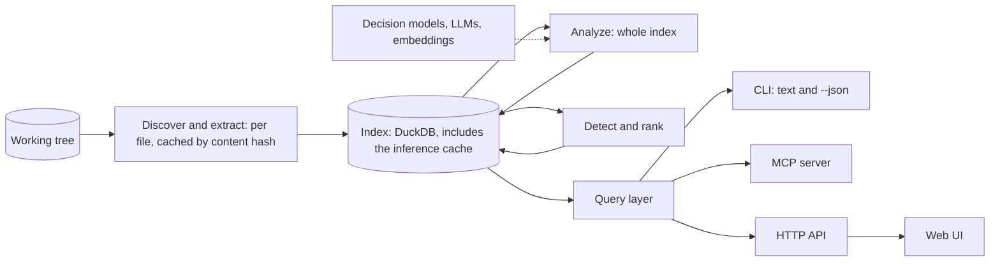
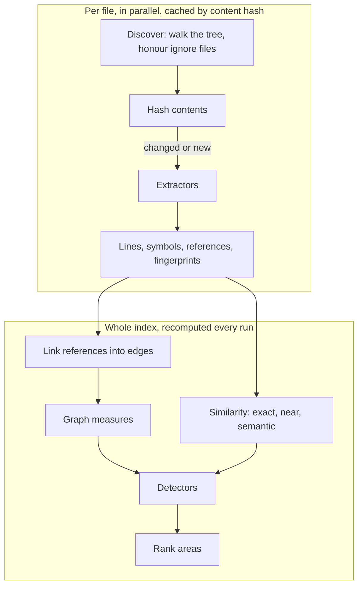
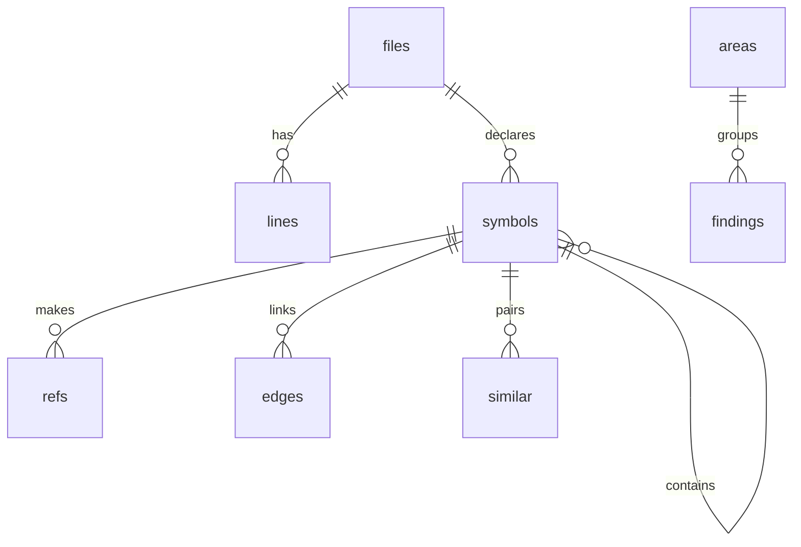
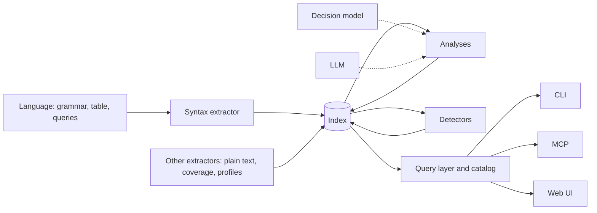

# codemap: Architecture

How codemap is built. Read `INTENT.md` first. This document holds the load-bearing decisions;
changing one is a deliberate call that rewrites the line here in the same change.

## Summary

One self-contained Rust binary, with the web UI and the database engine embedded.
`codemap index` turns a directory into an **index**: a DuckDB database of line-level facts,
symbols, references and similarities, kept in the project. **Analyses** enrich the index, and
**detectors** turn it into ranked **areas**. One **query layer** answers every question, and
every surface (CLI, MCP, web UI) is a thin shell over it. `codemap serve` keeps the index fresh
and serves the UI.



Load-bearing decisions:

1. **Lines are the unit of attribution.** Every measure is a sum over lines, so every view is a
   `GROUP BY`.
2. **Incremental at the leaves, recomputed at the joins.** Per-file facts are cached by content
   hash; everything that spans files is recomputed on each index.
3. **One query layer.** CLI, MCP and UI ask the same typed questions and get the same answers.
   No surface computes a number of its own.
4. **The core owns every derived value; surfaces only present.** The UI draws what the server
   says: sizes, colour steps, reasons. It never recomputes a metric, threshold or percentile.
5. **Extension points are traits plus a registry line.** The shipped languages, analyses and
   detectors use the same traits as any added later; none has a private path.
6. **Model answers are cached by content.** Re-indexing an unchanged codebase calls no model.

## Pipeline



1. **Discover.** Walk the root, honouring `.gitignore` and similar files. No version control is
   required.
2. **Hash and diff.** Hash every file and compare with the index. Deleted files lose their rows,
   changed and new files are extracted again, the rest are untouched.
3. **Extract.** A pure function of a file's path and bytes: line facts, symbols, raw references
   by name, and similarity fingerprints.
4. **Analyze.** Cross-file work over the whole index: resolve references into edges, find
   similar symbols, compute graph measures, ask models for classifications. Analyses write
   labels and measures back, so detectors and views use them like any built-in dimension.
5. **Detect and rank.** Each detector queries the index and emits findings; findings are grouped
   into areas and ordered by opportunity.

Whole-index work is SQL and graph passes over at most a few hundred thousand symbols, which take
seconds; tracking its dependencies would cost more code than it saves time. The expensive
per-unit work (parsing, embeddings, model calls) is cached by content, so it is incremental
anyway.

**Staleness.** The index records the build of codemap that wrote it. A different build
re-extracts every file; cached model answers survive, because their keys do not depend on the
build.

**Serving keeps it fresh.** `codemap serve` indexes on start, watches the tree, re-indexes
changed files after a short quiet period, and tells open pages to refresh. A re-index is one
transaction, so a request reads the whole previous state or the whole new one.

## Data model

Everything codemap keeps for a project lives in `.codemap/` at its root: `config.toml`
(committed) and `index.duckdb` (the facts and the inference cache, never committed; codemap
writes a `.gitignore` beside it that ignores everything but the config). A project is
self-contained.

**Worktrees start warm.** When a git worktree or jj workspace has no index yet, codemap copies
the main checkout's index if there is one; the next hash-and-diff brings it up to date. This is
the only thing codemap asks version control: where the main checkout is.



- **`lines`**: one row per line of every indexed file, with tokens, syntax nodes, nesting depth,
  role, concern and the innermost symbol. A line has one role and one concern, taken from the
  innermost classified node that covers it.
- **`symbols`**: modules, types, functions, tests and document sections, each with its line
  range, parent and content hash.
- **`refs`** are names as written; **`edges`** are references resolved to symbols, with a
  confidence, because resolution is by name and can be ambiguous (the rules are in
  `core/src/link.rs`). Symbols also record, from their shape alone, the callee a function only
  forwards its arguments to and whether a type exists to be implemented; **`switches`** holds
  the case set of every `match`, `switch` and `if` chain over constants.
- **`similar`** pairs symbols with a kind (exact, near, semantic) and a score: enough pairs to
  connect each cluster of copies, not every pair inside it. **`duplicated`** marks the lines of
  every copy but the longest in each cluster, which is what the `duplicated_lines` base measure
  sums.
- **`labels`** and **`measures`** (subject, key, value) are open tables: an analysis adds a
  dimension or measure by writing rows, not columns.
- **`findings`** and **`areas`**: see Detectors.
- **`embeddings`** and **`answers`**: the inference cache. A vector is keyed by content hash and
  model; a decision model's answer by the two content hashes (ordered), model and prompt
  version. Neither is derived from the build, so they survive a re-extract.

Hierarchical dimensions (path, symbol nesting) are paths, so grouping at any depth is a prefix.

**Why lines and not spans.** Line rows make every view a plain aggregate with no interval joins,
and a million of them scan in milliseconds. Structure lives in `symbols`, whose ranges are the
spans that matter. The cost is that a line mixing two concerns counts toward one; that is
accepted until a view shows it matters.

**Measures are computed when asked.** Only base measures (lines, tokens, nodes, and what
analyses write) are stored. A measure in a query is a sum of a base measure under a filter, or a
ratio of two such sums, such as handling lines over core lines. The catalog names the common
ones, the project config can name more, and any query (from the CLI, an agent or the UI) can pass
one inline.

## Extension points

Everything codemap knows comes through five extension points, each a Rust trait (for languages,
a data table) registered with one line in a static list. They are compiled in; "plugin" means a
seam with a registry, not a dynamic library.



| Point | Contract | Shipped first |
|---|---|---|
| **Language** | A grammar; a table mapping node kinds to generic kinds (function, type, abstraction, branch, conditional, switch, loop, handler, assertion, call, comment, string, import); definition and reference queries, which also name what a type implements. One file plus query files. | Rust, Python, TypeScript/JavaScript, Go, Svelte, Markdown |
| **Extractor** | Turns an input into facts keyed to files, lines or symbols. | Syntax (driven by Languages), plain text for every other file. Later: coverage, profiles, test durations |
| **Analysis** | Reads the index; writes edges, similar pairs, labels or measures; declares what it reads and writes. | Link (edges, fan-in and fan-out), similarity |
| **Detector** | Reads the index; emits findings with measures and evidence. Detector-specific detail is data on the finding, never a new type. | The eight above-the-fold detectors in `INTENT.md` |
| **Decision model** / **LLM** | Typed questions in, probabilities out / text in, text out. | Two vendors each |

- **Built-ins use the seams.** A shipped detector has no access a new one would lack; that is
  how the seams stay honest.
- **Languages are data first.** A language that needs more than its table, its queries and
  about fifty lines of exceptions (Svelte's embedded scripts, Rust's inline test modules) is a
  sign the generic model is wrong.
- **A detector never sees a language.** It sees lines, symbols, edges, labels and measures.
- **Adding one never touches the others.** A new language, extractor, analysis or detector is
  its own file, its fixtures, and one registry line; CLI, MCP and UI find it through the registry
  and the catalog.
- **Runtime data is an extractor.** Coverage, profiles, traces or test timings arrive as files
  other tools wrote and become measures on files, lines or symbols.

## Detectors, findings and areas

A **finding** is one detector's observation about a subject (a path, a symbol, or a group such as
a duplicate cluster), with the measures that triggered it, evidence (line ranges, related
symbols) and a reason in words. It carries no verdict.

An **area** is a subject with one or more findings. Its **opportunity** grows with the number of
distinct detectors that agree and with the mass involved; confidence only breaks ties.

Detectors compare the codebase with itself by default: outliers against its own distribution,
concentrations against its own totals. Two project inputs adjust this:

- **Rules** set a threshold on one measure at one granularity ("handling lines per function at
  least 100"). Rules are one generic detector driven by configuration.
- **Acknowledgements** mark areas whose complexity is essential, optionally per detector, with a
  reason. Acknowledged areas stay visible, ranked after the rest, and counted.

## Inference

Deterministic analyses always run. Analyses that need a model run when one is configured.

- **Semantic similarity** is two steps. Embeddings give every symbol a vector, and an exact
  nearest-neighbour search finds candidate pairs, including across languages. A decision model
  then confirms each candidate ("do these do the same thing?"). Embeddings are what make this
  affordable: asking a model about every pair is quadratic, and embedding a symbol costs a
  fraction of a cent once.
- **Decision models** answer high-volume typed questions with probabilities and no prose: same
  intent, which concern, whether a test meets the project's criteria.
- **LLMs** do what needs words: naming a cluster, saying why an area stands out.

Decision models and LLMs are traits, each with two vendors' APIs. Embeddings use one
OpenAI-compatible client, which most embedding providers speak. Tests seed the `embeddings` and
`answers` tables instead of mocking a client.

Semantic duplication runs after the deterministic analyses have committed, outside their
transaction, and only when `[inference]` names both models and the environment holds the key;
otherwise `codemap index` says in one line that it is off and why. Candidates are the nearest
neighbours of each function above a similarity floor, minus pairs already connected, strongest
first and within a per-run call budget; what the budget leaves is asked on later runs. A
confirmed pair joins the clusters of exact and near copies, and the findings say the group was
found by meaning. A model API that fails leaves the deterministic results standing.

## Query layer and surfaces

The query layer is one `Query` enum, answered by one function, returning one `Answer` enum in a
versioned envelope. Each variant has its own typed arguments and payload. Keeping them in one
enum means adding a query is a compile error in every surface until each handles it, so the
surfaces cannot drift.

| Query | Answers |
|---|---|
| `Overview` | Totals and shares by role, concern and language; counts of areas by detector |
| `Tree` | A hierarchy (path or symbol) with a size measure and a colour measure, under filters |
| `Xtab` | Two dimensions crossed, one measure per cell, under filters |
| `Areas` | Ranked areas, top N, under filters |
| `Area` | One area: findings, measures, evidence, related areas |
| `Source` | One file's lines with syntax highlighting and finding ranges |
| `Catalog` | Dimensions, measures and detectors available |

- **CLI.** A verb per query (`codemap overview`, `codemap areas --top 20`, `codemap xtab --rows
  role --cols concern`), plus `index`, `serve` and `mcp`. Human text by default, the envelope
  with `--json`. Paths are relative to the root.
- **MCP.** One tool per query, same arguments, same envelope; one tool each is how agents
  discover them.
- **HTTP.** `POST /api/query` taking a `Query` and returning the `Answer` in its versioned
  envelope. Its only client is the bundled UI, whose TypeScript types are generated from the Rust
  types, so a typed RPC needs no route table or OpenAPI document. `GET /api/events` is a server-sent stream of `Refresh`
  events: the current revision on connecting, then one per completed re-index.
- **Skill.** A plain Markdown skill that teaches any agent the triage workflow: overview, top
  areas, drill in, investigate with its own tools.

Agents get aggregates first and choose how deep to go with `--top` and drill-downs.

## Web UI

React and TypeScript built with Vite, embedded in the binary. React draws the chrome (filters,
breadcrumbs, tables, panels); views that draw many marks are framework-free canvas modules.

- **Views:** a flat treemap, a cross-tab heatmap, the area queue and a source
  viewer. A code city may follow, reusing the treemap's layout.
- **Every canvas is `scene = layout(data, size)` then `paint(scene)`.** Layout is pure and
  property-tested; paint only draws. Picking uses an id buffer.
- **The URL is the state.** Hierarchy, measures, filters, drill path and selection live in the
  query string, so every view is a link an agent can hand to a person.
- **Selection becomes a filter.** Clicking a cell or rect narrows the other views.
- **No client state machinery.** The UI only reads: one fetch hook keyed by the URL, which shows
  an answer only for its own key, covers it. No engine runs in the browser.

`DESIGN.md` owns how it looks.

## Configuration

- **`.codemap/config.toml`** holds project facts: role overrides by glob, named measures,
  rules, acknowledgements and model choices (`[inference]`: the embedding and decision models,
  the API's base URL, and the name of the environment variable that holds its key). It is
  optional and committed with the project.
- **Flags** cover only the invocation: what to show, where to listen.
- **Environment** holds only API keys.

## Code layout

A Cargo workspace whose crates follow build boundaries, so that the common edit rebuilds little
and independent crates build in parallel.

```
crates/
  lang/          grammars and their tables: slow C builds, rarely changed
  core/          index, extractors, analyses, detectors, query, inference (DuckDB, tree-sitter)
  codemap/       the binary: CLI, MCP, HTTP server, watcher, embedded UI (axum, rust-embed)
web/             the UI (React, Vite, d3-hierarchy; three.js loaded lazily for the city)
design/          tokens, base styles, fonts
skills/codemap/  the agent skill
```

Inside `core`, each language, extractor, analysis and detector is one file. A further split
follows a measured build-time win, never organization alone. Each dependency's manifest entry
says in one line why it is there.

## Assumptions and limits

- **One codebase, one machine, one user.** Up to a few million lines and a few hundred thousand
  symbols; whole-index passes are designed for that size.
- **Name-resolved references are approximate.** Edges carry a confidence; precise resolution
  from external indexers can be added later as an extractor.
- **Limits are named constants** with the reason for their value beside them, not settings.
