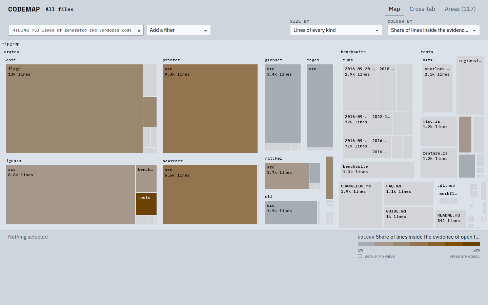
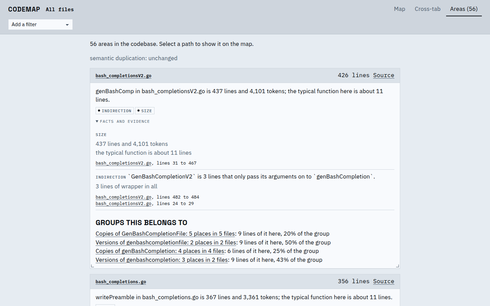
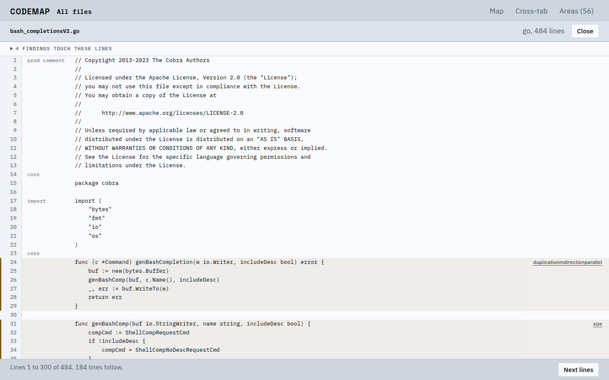
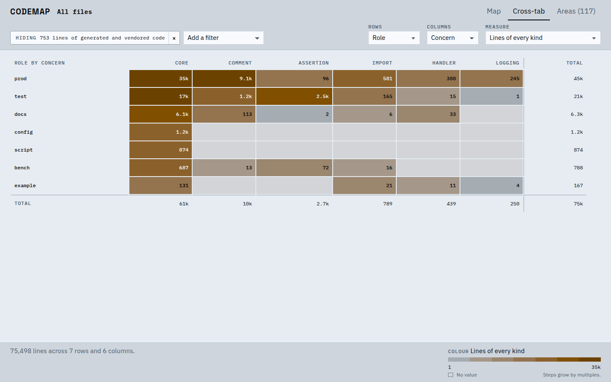

# codemap

A profiler for code mass and structure. codemap indexes a codebase and ranks the places where
its size and its accidental complexity lie, so that a person or a coding agent knows where to
look and what to cut. It points; it does not diagnose.



## Why

Codebases now grow faster than people read them. Agents write more code than they need: more
handling, more tests, more layers, more documents, the same idea built twice. Each addition is
reasonable on its own; together they bury the essential parts. codemap makes that mass visible,
the way a disk-usage map makes a full disk legible, and ranks the areas most worth a closer look.
You, or your agent, investigate them and decide what to change.

## Quick start

There is no release yet; build from source with [mise](https://mise.jdx.dev), which installs the
pinned Rust and Node and fetches the rest:

```sh
mise install                      # Rust, Node and the check tools
mise run build:web                # the UI the binary embeds (also fetches npm packages and DuckDB)
cargo install --locked --path crates/codemap
```

Then, in the codebase you want to look at:

```sh
codemap overview                  # where the lines go, by role, concern and language
codemap areas --top 15            # the ranked areas worth a closer look
codemap serve                     # the map, cross-tab and areas in a browser at localhost:7878
```

```
$ codemap areas --top 3
56 areas (0 acknowledged), showing 3

#  lines  detectors          area
1    426  indirection, size  bash_completionsV2.go
      genBashComp in bash_completionsV2.go is 437 lines and 4,101 tokens; the typical function here is about 11 lines.
2    356  size               bash_completions.go
      writePreamble in bash_completions.go is 367 lines and 3,361 tokens; the typical function here is about 11 lines.
3    720  duplication        Copies of TestValidArgsFuncChildCmds: 11 places in 1 file
      11 near copies of a 26 to 103 line test in 1 file.
      id: group:duplication:c5f09ceb2bbd
```

The index lives in `.codemap/` and is brought up to date on every run; only what changed is
re-read.

## What it checks

Accidental complexity in the large shows up as **repetition** (the same intent built more than
once), **stacking** (layers that pass through, wrap or compensate for other layers) and
**disproportion** (far more handling, tests, configuration or prose than the code they serve).
Each detector compares the codebase with itself, so the bar is the project's own.

| Detector | Flags |
|---|---|
| **size** | Files and functions far larger than the rest, and directories holding more lines than their share of the files |
| **composition** | Files and directories where a role or concern takes far more of the lines than in their peers: error handling, tests, assertions, logging, comments, documentation |
| **duplication** | Functions and tests copied exactly, or nearly once names and constants are ignored, or (opt-in) confirmed by a model to do the same thing in different words |
| **parallel** | Names that are versions of each other (`Foo`, `FooV2`, `LegacyFoo`), and the same set of cases matched in several places with catch-alls, constant tables or one real arm |
| **indirection** | Functions that only pass calls on, and abstractions with a single implementation |
| **rules** | Places that break a threshold the project set itself, such as "at most 100 lines of error handling per function" |

Every line is attributed by path, language, symbol, **role** (prod, test, docs, config, script,
bench, example, generated, vendored) and **concern** (core, handler, assertion, logging,
comment, import). Generated and vendored lines are never ranked.

Areas are ranked by **opportunity**: how much mass is at stake, raised when several detectors
flag the same lines. Test code counts for less than production code, but it is never hidden.

## How it reads

**Areas** lists what to look at, each with the facts behind it, its evidence as line ranges, and
the groups it belongs to.



**Source** shows a file with each line's role and concern and the findings that touch it.



**Cross-tab** crosses any two dimensions with any measure: role by concern, language by role,
directory by concern.



Every view filters by any dimension, drills into a directory, and pivots to another view of the
same lines.

## For coding agents

- Every query takes `--json`: `overview`, `tree`, `xtab`, `areas`, `area <subject>`,
  `source <file>`, `catalog`.
- `codemap mcp` serves the same queries as MCP tools on stdin and stdout.
- [`skills/codemap/SKILL.md`](skills/codemap/SKILL.md) is a skill that walks an agent through
  setup, triage and investigation.

## Configuration

Optional, in `.codemap/config.toml`; commit it with the project.

```toml
# Fix roles that path conventions get wrong. Gitignore-style globs; the first match wins.
[roles]
"third_party/" = "vendored"
"testdata/" = "test"

# Complexity that is there on purpose stays visible but ranks after the rest.
[[acknowledge]]
path = "src/parser"
detector = "size"
reason = "hand-written parser tables"

# The project's own bar.
[[rule]]
name = "long handling"
measure = "handler_lines"
per = "function"
at_most = 100

# Semantic duplication through a model provider (OpenRouter by default; the key comes from the
# environment). An empty table uses the default models.
[inference]
```

## Languages

Rust, Python, JavaScript, TypeScript (with TSX) and Go are parsed into symbols. Every other file
is still counted by lines and role.

## What it is not

Not a linter, not a verdict (no grades, gates or health score), not code search, not context for
agents during development, not a pull-request reviewer and not a service. It never runs the code
it indexes and needs no version-control history.

## Documents

- [INTENT.md](INTENT.md): what codemap is for, and what it is not
- [ARCHITECTURE.md](ARCHITECTURE.md): how it is built
- [DESIGN.md](DESIGN.md): how it looks and reads
- [PRACTICES.md](PRACTICES.md): how code is written and checked
- [AGENTS.md](AGENTS.md): the entry point for coding agents

Licensed under [Apache-2.0](LICENSE).
